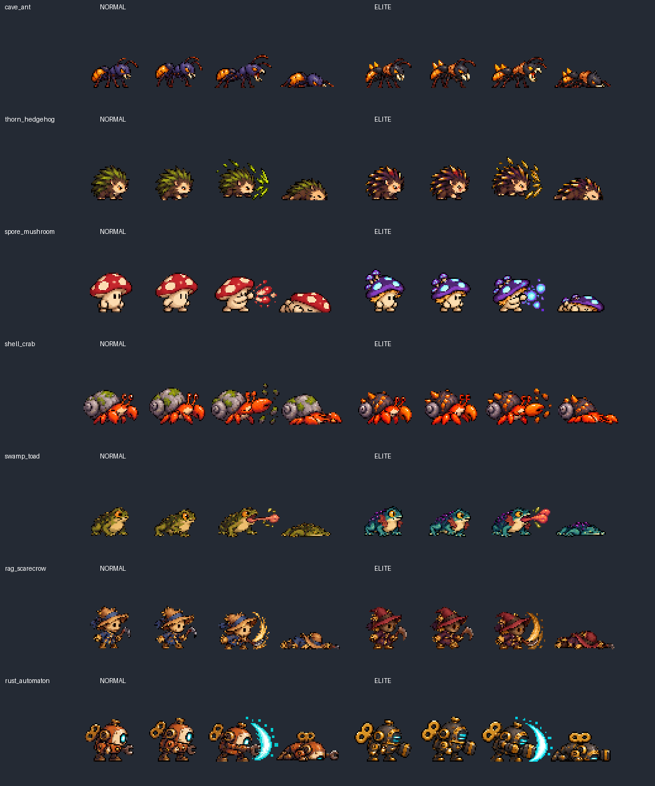

# 일반 몬스터 후보7종 — 에셋 전용 2026-10-15

기존 등록 일반등급16종에 추가할7종을 제작했다. 준비된 종류는 총23종이지만 **이번 작업은 에셋만 추가**했으므로 실제게임의 등록 일반등급은16종 그대로다. 전투수치/스킬/특수증강/소환/뽑기/컬렉션/도감/승률은 바꾸지 않았다.

| 이름 | 폴더ID | 기준 본체높이 |
|---|---|---:|
| 동굴개미 | `cave_ant` | `24px` |
| 밤가시고슴도치 | `thorn_hedgehog` | `28px` |
| 포자버섯 | `spore_mushroom` | `32px` |
| 돌껍질소라게 | `shell_crab` | `28px` |
| 늪지두꺼비 | `swamp_toad` | `24px` |
| 누더기허수아비 | `rag_scarecrow` | `34px` |
| 녹슨태엽병 | `rust_automaton` | `34px` |

일반 `assets/art/monsters/<id>/`, 엘리트 `assets/art/elitemonster/<id>/`로 정리했다. 각 폼마다 원본PNG·정규화시트·개별23프레임·manifest·Godot SpriteFrames/프리뷰씬·README를 제공한다. 일반/엘리트 총14폼,분리322장. 초상화/스탯/게임등록은 포함하지 않는다. ZIP중복본은 저장소에 넣지 않았다.

## 확인



[23프레임 동작 미리보기](art/common_monsters_7/animations.gif). 문서프리뷰는 배경/영문라벨이있는합성확인용이며,실제시트/프레임은배경·라벨없는투명PNG다. Godot에서는 각폴더 `*_preview.tscn`의 AnimatedSprite2D animation을 선택한다. 이번 환경에서 Godot실행검사는 하지 않았다.

## 제작·분리

내장 image_gen으로 일반폼7장과 각일반폼을정체성레퍼런스로한엘리트7장을각각생성했다. Stage8소환용사시트는 그림체만참조했다. 엘리트는 갑각/결정가시·모자/의상·태엽/팔장비 등 외형차이를추가했다. 실제최종해상도는생성엔진출력에따라다르며원본을정규격격자로오인해등분하지않는다.

원본RGBA는그대로보존한다. 최종은알파128기준이진화,동일폼전체에한배율nearest축소만적용한다. 검정RGB로배경을지우지않아눈·입·소재내부를보존한다. 투명골을기준으로원본행/열을추출하며,긴혀/공격으로가로투영범위만겹치는경우2D연결영역을분리하고가까운파편을해당본체에귀속한다. 붙어분리불가능한본체는자동제작을거부한다.

96×80셀,공통몸통중심X48/발끝경계Y68. 생성원본의실제동작변형은보존하고,정수리사이즈·발위치흔들림은고정배율/발끝보정으로줄였다. 기준본체24~34px는종의의도된체형이며엘리트도동일기준이다. 최종시트576×400,행순서idle4/move6/attack6/hit3/death4,나머지셀투명. 별도그림자·HP바는그리지않아추후런타임접지에서이중표시를피한다.

실제프롬프트와원본경로는 [재생성 입력](COMMON_MONSTER_ART_SOURCES_20261015.json) 및각manifest에기록했다. 새로이미지를생성하는API코드가아닌분리도구이며,재정리명령은아래와같다. Python Pillow/numpy/scipy가필요하다.

```bash
python tools/package_common_monster_art.py docs/COMMON_MONSTER_ART_SOURCES_20261015.json
python tools/audit_common_monster_art.py
```

## 검증과 범위

정적1891검사PASS: 14원본SHA/14폼/322프레임,RGBA·투명알파0/255,셀96×80,발끝Y68,4px이상여백,빈셀투명,분리프레임과시트픽셀완전일치,폼내동일프레임중복없음,manifest순서/FPS/loop,23개SpriteFrames경로,프리뷰pivot. 대표대기/걷기/공격/사망포즈의일반·엘리트14폼도이미지로확인했다. `git diff --check` PASS.

실제Godot애니메이션재생·GPU/모바일·전투정렬/루프체감은미검증이다. 기존SpriteFrames와동일형식으로제공하지만신규종은아직전투에등록하지않았다. 이번생성은에셋준비이며인게임23종추가완료로해석하지않는다.
