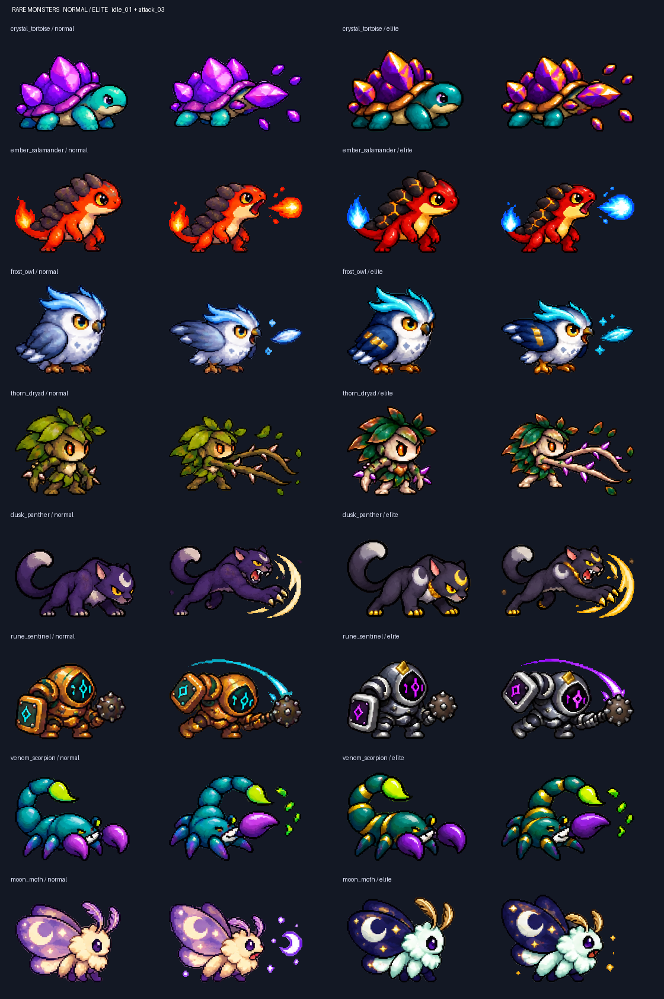

# 신규 희귀 몬스터8종 · 2026-10-16

희귀7→15종. 일반23·고급16종 유지. 마왕레벨1·강화0·연구0·무증강 기준. 아래 기본 전투값은 희귀의 HP×1.10·공격×1.12·이속×1.03·간격×0.96 적용값이며 원본값을 함께 명시한다. 엘리트 추가배율·성장·증강은 별도다. 거리/속도는 월드px·초. 등급 내 개별 뽑기확률은 종류 수에 따라 분산되고, 등급별 확률·저장 스키마는 기존 경로를 따른다. 계정 자동지급 없이 뽑기·조각해금·편성에 등록한다.

## 수정등거북

이름: 수정등거북 (`crystal_tortoise`)\
등급: 희귀\
종류: 짐승\
역할: 탱커\
이속: 59.74 (원본 58)\
공격종류: 근접 단일\
사거리,투사체속도: 92 / 해당 없음\
공격력: 48 (원본 43)\
공속: 0.417회/초 (2.4초 간격, 원본 2.5초)\
체력: 405 (원본 368)\
코스트: 17 지휘력\
특징: 등장 시 최대체력30% 보호막. 느린 근접 탱커로 원거리 추격이 약하다.

특수증강:

- **겹수정 등딱지**: 등장 보호막30%→45%. 기존 개체는 증가분만1회 지급.
- **단단한 결정핵**: 최대체력20% 증가.
- **구르는 수정발**: 이동속도20% 증가.

엘리트스킬:

- **수정 재결정**: 자신의 보호막을 최대체력40%까지 보충. 남은 잔량과 합산하지 않고 큰 값으로 갱신. 첫 대기4초 / 재사용20초.
- **등갑 내려찍기**: 대상 위치를0.65초 예고 후 반경115px 안 대상1명에 공격력150% 피해·1초25% 둔화. 원 밖으로 피하면 불발. 첫 대기4초 / 재사용18초.

예산 검토: 등장 시 최대체력30% 보호막. 느린 근접 탱커로 원거리 추격이 약하다. 고유 능력·엘리트 기여를 몸체/직접DPS 예산에서 할인. 실전 승률 미검증.
HP계수 0.76, 직접DPS계수 0.87, 반복공격주기계수 1.

## 잿불도롱뇽

이름: 잿불도롱뇽 (`ember_salamander`)\
등급: 희귀\
종류: 짐승\
역할: 원거리\
이속: 92.7 (원본 90)\
공격종류: 회피 가능한 직선 단일 투사체\
사거리,투사체속도: 355 / 340\
공격력: 43 (원본 38)\
공속: 0.631회/초 (1.584초 간격, 원본 1.65초)\
체력: 207 (원본 188)\
코스트: 15 지휘력\
특징: 직선 불씨탄에 공격력25%의2초 화상. 접근당하면 취약하다.

특수증강:

- **살아있는 잿불**: 화상 총피해 공격력25%→45%.
- **긴 불숨**: 사거리355→435·투사체속도340→420.
- **뜨거운 박동**: 공격 간격12% 감소.

엘리트스킬:

- **세갈래 잿불**: 지정 방향으로 3갈래 직선탄. 각 공격력65% 피해, 회피 가능. 기본 공격의 상태효과를 계승. 첫 대기4초 / 재사용18초.
- **화염 낙인**: 대상 위치를0.65초 예고 후 반경115px 안 대상1명에 공격력140% 피해와 해당 피해40%의2초 화상. 피하면 불발. 첫 대기4초 / 재사용20초.

예산 검토: 직선 불씨탄에 공격력25%의2초 화상. 접근당하면 취약하다. 고유 능력·엘리트 기여를 몸체/직접DPS 예산에서 할인. 실전 승률 미검증.
HP계수 0.88, 직접DPS계수 0.76, 반복공격주기계수 1.

## 서리깃올빼미

이름: 서리깃올빼미 (`frost_owl`)\
등급: 희귀\
종류: 짐승\
역할: 제어\
이속: 87.55 (원본 85)\
공격종류: 회피 가능한 직선 단일 투사체\
사거리,투사체속도: 335 / 310\
공격력: 27 (원본 24)\
공속: 0.548회/초 (1.824초 간격, 원본 1.9초)\
체력: 254 (원본 231)\
코스트: 14 지휘력\
특징: 얼음깃 직선탄이1초18% 둔화. 직접 화력보다 아군의 접근을 돕는다.

특수증강:

- **매서운 서리깃**: 기본탄 둔화18%→27%.
- **늦겨울의 숨**: 기본탄 둔화1초→1.4초.
- **찬바람 활공**: 이동속도15%·투사체속도310→390.

엘리트스킬:

- **서리깃 부채**: 지정 방향으로 3갈래 직선탄. 각 공격력55% 피해, 회피 가능. 기본 공격의 상태효과를 계승. 첫 대기4초 / 재사용18초.
- **동결 표식**: 대상 위치를0.65초 예고 후 반경115px 안 대상1명에 공격력100% 피해·1.3초35% 둔화. 피하면 불발. 첫 대기4초 / 재사용19초.

예산 검토: 얼음깃 직선탄이1초18% 둔화. 직접 화력보다 아군의 접근을 돕는다. 고유 능력·엘리트 기여를 몸체/직접DPS 예산에서 할인. 실전 승률 미검증.
HP계수 0.9, 직접DPS계수 0.72, 반복공격주기계수 1.

## 가시덩굴드리아드

이름: 가시덩굴드리아드 (`thorn_dryad`)\
등급: 희귀\
종류: 식물\
역할: 제어\
이속: 78.28 (원본 76)\
공격종류: 근접 단일\
사거리,투사체속도: 130 / 해당 없음\
공격력: 32 (원본 29)\
공속: 0.521회/초 (1.92초 간격, 원본 2초)\
체력: 300 (원본 273)\
코스트: 16 지휘력\
특징: 근접 가시채찍에1.1초22% 둔화. 전선 뒤에서 묶으며 원거리 견제에 약하다.

특수증강:

- **휘감는 가시**: 기본공격 둔화22%→32%.
- **깊은 뿌리**: 최대체력25% 증가.
- **뻗어가는 덩굴**: 공격 사거리130→180.

엘리트스킬:

- **뿌리 얽기**: 대상 위치를0.65초 예고 후 반경115px 안 대상1명에 공격력110% 피해·1.5초40% 둔화. 피하면 불발. 첫 대기4초 / 재사용18초.
- **숲의 가시울타리**: 주변240px 내 자신을 제외한 아군 최대3명에 각 최대체력12% 보호막. 중첩 없이 큰 잔량으로 갱신. 첫 대기4초 / 재사용20초.

예산 검토: 근접 가시채찍에1.1초22% 둔화. 전선 뒤에서 묶으며 원거리 견제에 약하다. 고유 능력·엘리트 기여를 몸체/직접DPS 예산에서 할인. 실전 승률 미검증.
HP계수 0.93, 직접DPS계수 0.73, 반복공격주기계수 1.

## 황혼표범

이름: 황혼표범 (`dusk_panther`)\
등급: 희귀\
종류: 짐승\
역할: 근접 마무리\
이속: 135.96 (원본 132)\
공격종류: 근접 단일\
사거리,투사체속도: 85 / 해당 없음\
공격력: 31 (원본 28)\
공속: 0.992회/초 (1.008초 간격, 원본 1.05초)\
체력: 141 (원본 128)\
코스트: 14 지휘력\
특징: 생애 첫 기본공격180%, 체력25% 이하 대상에 피해20% 추가. 몸체가 약한 근접 마무리 딜러.

특수증강:

- **황혼의 기습**: 첫 기본공격180%→230%. 이미 소모한 첫 공격은 복구하지 않음.
- **끝장을 보는 발톱**: 처형 발동 체력25%→35%, 추가피해20%→30%.
- **포식의 숨결**: 실제 감소시킨 체력의12% 회복.

엘리트스킬:

- **달그림자 도약**: 대상 위치를0.65초 예고 후 반경115px 안 대상1명에 공격력180% 피해. 피하면 불발. 종료 후1.5초 이속20% 증가. 첫 대기4초 / 재사용16초.
- **황혼의 포식**: 대상 위치를0.65초 예고 후 반경115px 안 대상1명에 공격력120% 피해, 실제 체력피해의20% 회복. 피하면 불발. 첫 대기4초 / 재사용22초.

예산 검토: 생애 첫 기본공격180%, 체력25% 이하 대상에 피해20% 추가. 몸체가 약한 근접 마무리 딜러. 고유 능력·엘리트 기여를 몸체/직접DPS 예산에서 할인. 실전 승률 미검증.
HP계수 0.9, 직접DPS계수 0.84, 반복공격주기계수 1.

## 룬방패수호병

이름: 룬방패수호병 (`rune_sentinel`)\
등급: 희귀\
종류: 구조체\
역할: 탱커\
이속: 72.1 (원본 70)\
공격종류: 근접 단일\
사거리,투사체속도: 100 / 해당 없음\
공격력: 38 (원본 34)\
공속: 0.473회/초 (2.112초 간격, 원본 2.2초)\
체력: 469 (원본 426)\
코스트: 18 지휘력\
특징: 등장 보호막20%, 매3회 공격마다 주변200px 아군2명에6% 갱신형 보호막. 낮은 단독 화력.

특수증강:

- **이중 방호룬**: 등장 보호막20%→35%. 기존 개체는 증가분만1회 지급.
- **공명 각인**: 공격 연동 아군 보호막6%→10%.
- **넓은 수호진**: 공격 연동 보호 범위200→270px·대상2→3명.

엘리트스킬:

- **룬의 방벽**: 주변240px 내 자신을 제외한 아군 최대3명에 각 최대체력15% 보호막. 중첩 없이 큰 잔량으로 갱신. 첫 대기4초 / 재사용20초.
- **수호핵 재충전**: 자신의 보호막을 최대체력35%까지 보충. 남은 잔량과 합산하지 않고 큰 값으로 갱신. 첫 대기4초 / 재사용22초.

예산 검토: 등장 보호막20%, 매3회 공격마다 주변200px 아군2명에6% 갱신형 보호막. 낮은 단독 화력. 고유 능력·엘리트 기여를 몸체/직접DPS 예산에서 할인. 실전 승률 미검증.
HP계수 0.83, 직접DPS계수 0.74, 반복공격주기계수 1.

## 독침전갈

이름: 독침전갈 (`venom_scorpion`)\
등급: 희귀\
종류: 짐승\
역할: 원거리\
이속: 82.4 (원본 80)\
공격종류: 회피 가능한 직선 단일 투사체\
사거리,투사체속도: 300 / 285\
공격력: 53 (원본 47)\
공속: 0.496회/초 (2.016초 간격, 원본 2.1초)\
체력: 213 (원본 194)\
코스트: 16 지휘력\
특징: 직선 독침 적중 시 현재체력0.2%를3초간 독 피해. 짧은 사거리·느린 공격과 낮은 직접 피해.

특수증강:

- **농축 독낭**: 독 총피해 현재체력0.2%→0.35%.
- **가벼운 독침**: 사거리300→390·투사체속도285→390.
- **탈피 갑각**: 최대체력20% 증가.

엘리트스킬:

- **독침 삼연사**: 지정 방향으로 3갈래 직선탄. 각 공격력60% 피해, 회피 가능. 기본 공격의 상태효과를 계승. 첫 대기4초 / 재사용18초.
- **비취 탈피**: 자신의 보호막을 최대체력25%까지 보충. 남은 잔량과 합산하지 않고 큰 값으로 갱신. 첫 대기4초 / 재사용24초.

예산 검토: 직선 독침 적중 시 현재체력0.2%를3초간 독 피해. 짧은 사거리·느린 공격과 낮은 직접 피해. 고유 능력·엘리트 기여를 몸체/직접DPS 예산에서 할인. 실전 승률 미검증.
HP계수 0.85, 직접DPS계수 0.7, 반복공격주기계수 1.

## 달가루나방

이름: 달가루나방 (`moon_moth`)\
등급: 희귀\
종류: 짐승\
역할: 지원 사격 (게임태그: 원거리)\
이속: 94.76 (원본 92)\
공격종류: 회피 가능한 직선 단일 투사체\
사거리,투사체속도: 320 / 300\
공격력: 26 (원본 23)\
공속: 0.613회/초 (1.632초 간격, 원본 1.7초)\
체력: 284 (원본 258)\
코스트: 16 지휘력\
특징: 매3회 공격마다 주변240px 아군3명에 최대체력8% 갱신형 보호막. 사격을 지속해야 지원 가능.

특수증강:

- **짙은 달가루**: 공격 연동 아군 보호막8%→12%.
- **만월의 박동**: 아군 보호막 발동 매3회→2회 공격.
- **은빛 비늘날개**: 최대체력15%·이동속도15% 증가.

엘리트스킬:

- **달빛 장막**: 주변240px 내 자신을 제외한 아군 최대3명에 각 최대체력16% 보호막. 중첩 없이 큰 잔량으로 갱신. 첫 대기4초 / 재사용20초.
- **초승달 날갯짓**: 지정 방향으로 3갈래 직선탄. 각 공격력55% 피해, 회피 가능. 기본 공격의 상태효과를 계승. 첫 대기4초 / 재사용18초.

예산 검토: 매3회 공격마다 주변240px 아군3명에 최대체력8% 갱신형 보호막. 사격을 지속해야 지원 가능. 고유 능력·엘리트 기여를 몸체/직접DPS 예산에서 할인. 실전 승률 미검증.
HP계수 0.88, 직접DPS계수 0.72, 반복공격주기계수 1.

## 에셋 및 연결

imagegen 내장 도구로 기본8장·엘리트8장 제작. 기본형 `assets/art/monsters/<id>/`, 엘리트형 `assets/art/elitemonster/<id>/`. 각 원본 PNG·6열5행 시트·23개별프레임·SpriteFrames·프리뷰씬·manifest·README. 총16폼368프레임. 원본 크기1:1 유지, alpha128 경계 이진화만 적용. RGB 검정 제거·축소·재확대 없음. 반투명 경계 RGBA까지 원본과 동일하다는 뜻은 아니다. 몸통X/발끝Y·그림자·상태바를 정규화한다. 64px 초상화 대신 기존 도감 규칙의 idle 아이콘을 사용한다.

[정확한 프롬프트·참조·원본 경로](RARE_MONSTER_ART_SOURCES_20261016.json). 공통 Frontier 런타임·풀·피해영수증·세대핸들·공간조회 재사용. 고유ID 전투 분기나 전체스캔 루프를 추가하지 않는다. 도감/가챠/편성/일반·특수증강/전투소환/엘리트 변이에 등록. 보강 설치를5분 단1회로 끝내던 경로를 데이터의 등장시각별 체크포인트로 변경하여, 기존 고급420초와 신규 희귀540초에 한 번씩 추가한다. 설치 시점에 허용 등급의 시각 목록을 캐시하고, 평시 tick에서는 다음 시각만 비교한다. 시간점프로 여러 시각을 지나도 한 번만 최신 후보를 합치며 중복 등록하지 않는다. 용사모드는540초 이후 해당 희귀등급을 허용하는 단계에 보강되며, 제어형과 둔화 엘리트는 기존 CC 공급 제한을 따른다. 예고 공격은 범위 내 대상1명 판정이며 광역 전체피해로 표시하지 않는다. 독은 현재체력 비례 총피해·갱신형이라 같은 독을 무한 중첩하지 않는다. 보호막은 잔량 합산 없이 높은 값으로 갱신한다.

## 검증

Godot4.5.1 headless 격리: Frontier27종 실제씬·기본공격·81특수증강·37엘리트·실제Battle 소환/스탯상세·20단계 보강/300·420·540초 경계·시간점프3796, 희귀15·일반23·고급16/제어분류79, 기존밸런스411, 제어공급456, 기존초반공세6550 = 11292검사 통과. 전체65종 비용·역할 감사0이슈. 신규16폼368프레임 원본RGB/alpha·잘림/중복·시트정합 정적2545검사 통과. 원본PNG 없는 배포PCK에서1238프레임54폼 로드 통과. 신규 아트는 실파일이며 누락된 다른 아트/음원·일부표적/호스트는 대역. Android/GPU/FPS·실제15분완주·승률·시각적 루프 체감은 미검증.
