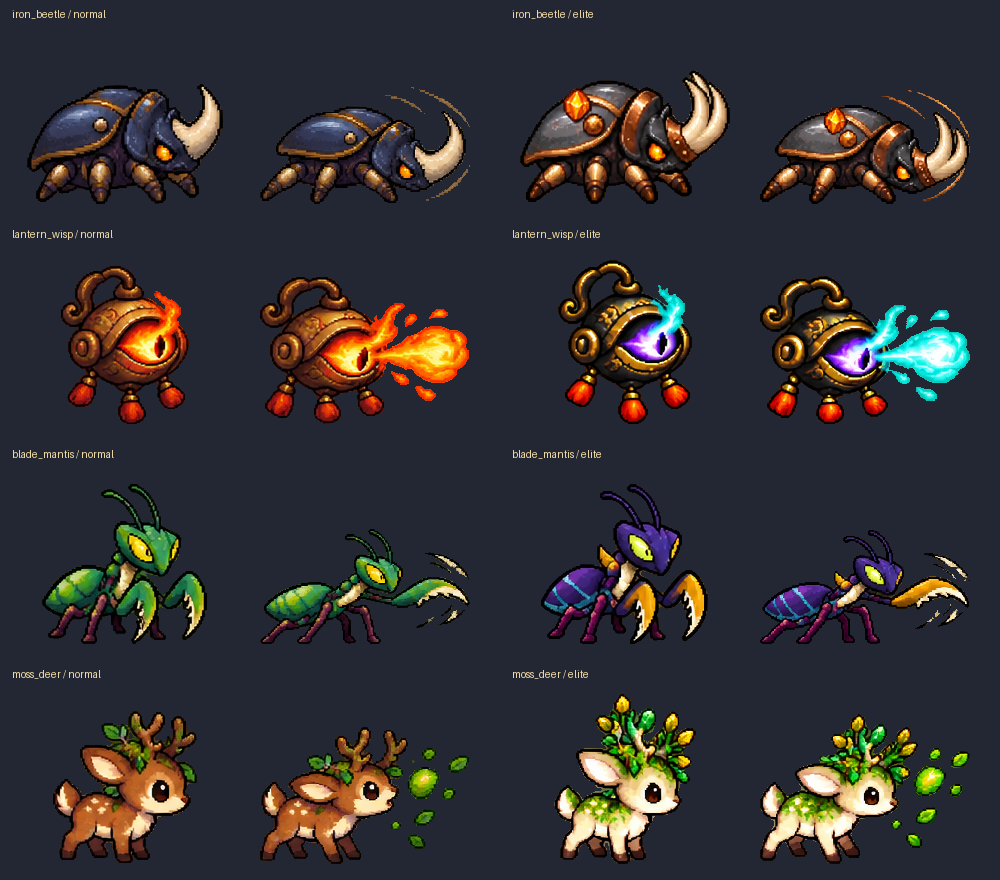

# 신규 고급 몬스터4종 · 2026-10-16

고급12종→16종. 마왕레벨1·강화0·연구0·무증강 기준이며, 고급은 기존 전투 배율1이라 원본과 기본 전투값이 같다. 거리/이속/투사체속도는 월드px·초. 엘리트는 기존 추가배율을 별도로 받는다. 일반23종 및 등급별 뽑기 확률은 유지하며 고급등급 내부의 개별 확률만 분산된다. 계정 자동 지급 없이 기존 뽑기·조각해금·편성 경로에 등록한다.

## 철갑장수풍뎅이

이름: 철갑장수풍뎅이 (`iron_beetle`)\
등급: 고급\
종류: 짐승\
역할: 탱커\
이속: 72\
공격종류: 근접 단일\
사거리,투사체속도: 90 / 해당 없음\
공격력: 26\
공속: 0.455회/초 (2.2초 간격)\
체력: 226\
코스트: 11 지휘력\
특징: 첫 기본공격140% 피해. 등장 시 최대체력40% 보호막을 얻는 전선 탱커. 느린 접근과 긴 공격 간격이 약점.

특수증강:

- **겹철 외피**: 등장 보호막40%→60%. 기존 개체는 증가분만1회 지급.
- **공성 뿔**: 첫 기본공격 피해140%→200%. 이미 소모한 첫 공격은 재충전하지 않음.
- **유연한 철관절**: 이동속도25% 증가.

엘리트스킬:

- **철옹의 등딱지**: 최대체력65% 보호막을 생성. 남은 보호막과 합산하지 않고 큰 값으로 갱신. 첫 대기4초 / 재사용18초.

예산 검토: 첫 기본공격140% 피해. 등장 시 최대체력40% 보호막을 얻는 전선 탱커. 느린 접근과 긴 공격 간격이 약점. 고유 생존/화상/연격/지원 기여를 HP·직접DPS 예산에 반영. 실전 승률 미검증.

## 등불도깨비

이름: 등불도깨비 (`lantern_wisp`)\
등급: 고급\
종류: 기체\
역할: 원거리\
이속: 94\
공격종류: 회피 가능한 단일 투사체\
사거리,투사체속도: 360 / 315\
공격력: 23\
공속: 0.588회/초 (1.7초 간격)\
체력: 106\
코스트: 9 지휘력\
특징: 회피 가능한 불씨탄 적중 시 해당 공격력30%를2초간 추가 화상 피해. 낮은 몸체 체력으로 중거리 화력을 지원.

특수증강:

- **길 잃은 불씨**: 불씨탄의 추가 화상 피해30%→50%.
- **긴 등불길**: 사거리360→460px·투사체속도315→420px/초.
- **도깨비 심지**: 공격력25% 증가.

엘리트스킬:

- **삼도천 길잡이**: 전방3방향으로 각 공격력65% 불씨탄을 발사. 탄마다 회피 가능하며 현재 불씨 화상 증강을 적용. 첫 대기3초 / 재사용15초.

예산 검토: 회피 가능한 불씨탄 적중 시 해당 공격력30%를2초간 추가 화상 피해. 낮은 몸체 체력으로 중거리 화력을 지원. 고유 생존/화상/연격/지원 기여를 HP·직접DPS 예산에 반영. 실전 승률 미검증.

## 쌍낫사마귀

이름: 쌍낫사마귀 (`blade_mantis`)\
등급: 고급\
종류: 짐승\
역할: 근접 돌파 딜러\
이속: 133\
공격종류: 근접 단일\
사거리,투사체속도: 96 / 해당 없음\
공격력: 20\
공속: 0.870회/초 (1.15초 간격)\
체력: 95\
코스트: 10 지휘력\
특징: 빠른 근접 낫 공격. 매3번째 공격180% 피해와1.2초 이속15% 증가. 광역 공격에 취약한 돌파 딜러.

특수증강:

- **월아 겹낫**: 매3번째 기본공격 피해180%→240%.
- **사냥꾼의 본능**: 대상 체력이30% 이하이면 기본공격 피해25% 증가.
- **날선 관절**: 공격 간격15% 감소.

엘리트스킬:

- **초승달 가르기**: 대상 위치를0.5초 예고 후 반경110px 안 대상1명에 공격력210% 피해. 원 밖으로 피하면 불발. 시전 종료 후1.5초 이속20% 증가. 첫 대기3초 / 재사용15초.

예산 검토: 빠른 근접 낫 공격. 매3번째 공격180% 피해와1.2초 이속15% 증가. 광역 공격에 취약한 돌파 딜러. 고유 생존/화상/연격/지원 기여를 HP·직접DPS 예산에 반영. 실전 승률 미검증.

## 이끼뿔사슴

이름: 이끼뿔사슴 (`moss_deer`)\
등급: 고급\
종류: 짐승\
역할: 원거리 / 아군 보호 지원\
이속: 100\
공격종류: 회피 가능한 단일 투사체\
사거리,투사체속도: 300 / 310\
공격력: 17\
공속: 0.526회/초 (1.9초 간격)\
체력: 170\
코스트: 10 지휘력\
특징: 씨앗탄을 발사하며 매3회 공격마다200px 내 아군 최대3명에게 각 최대체력6% 보호막. 자신은 제외, 같은 계열 보호막은 합산 없이 큰 잔량으로 갱신.

특수증강:

- **무성한 녹각**: 기본 보호막6%→10%·보호 범위200→260px.
- **신록의 맥동**: 보호막 발동이 매3회→2회 공격.
- **숲길 걸음**: 이동속도20% 증가·최대체력15% 증가.

엘리트스킬:

- **고목의 축복**: 260px 내 아군 최대4명에게 각 최대체력16% 보호막. 자신은 제외, 같은 계열 보호막은 합산 없이 큰 잔량으로 갱신. 첫 대기4초 / 재사용18초.

예산 검토: 씨앗탄을 발사하며 매3회 공격마다200px 내 아군 최대3명에게 각 최대체력6% 보호막. 자신은 제외, 같은 계열 보호막은 합산 없이 큰 잔량으로 갱신. 고유 생존/화상/연격/지원 기여를 HP·직접DPS 예산에 반영. 실전 승률 미검증.

## 에셋·연결

imagegen 내장 도구로 기본4장+엘리트4장 생성. 원본은 각 폼 source.png로 보존, 원본 크기1:1로 분리하여 총184프레임. 같은 폼 내 고정 셀·몸통X/발끝Y·6열5행 시트와 SpriteFrames/프리뷰씬/manifest를 제공한다. alpha128 경계 이진화만 적용하며 RGB 검정 제거/축소/재확대는 없다. 원본의 반투명 경계를 그대로 보존했다는 뜻은 아니다. PNG를 다시 그리는 대신 런타임에서 idle 실사용 bounds로 체급과 그림자·상태바를 맞춘다.

[정확한 생성 프롬프트·원본 위치](UNCOMMON_MONSTER_ART_SOURCES_20261016.json). 기본형 `assets/art/monsters/<id>/`, 엘리트형 `assets/art/elitemonster/<id>/`. 엘리트 사마귀 공격3프레임은 가로 투명 여백이1px라 검토한 source_crop으로 경계 투명1px를 추가해 보존 분리했다. 원본/출력 픽셀 검사를 수행한다.

실게임은 기존 Frontier 공통 공격/풀·세대핸들·피해영수증·엘리트 경로 재사용. 도감·가챠·조각해금·일반/특수증강·편성·실제 소환에 연결하며, 용사모드420초 이후 등급허용 단계에서 보강 후보가 된다. 신규 전투 핫패스 전체스캔/개체할당 루프 없음. 실제 기기 밸런스·FPS·완주·승률은 미검증이다.

## 검증

Godot4.5.1 headless 격리: Frontier19종 실제씬/기본공격/57특수증강/21엘리트·실제Battle·20단계 보강2099, 고급16·일반23 유지38, 기존밸런스411 = 2548검사 통과. 전체57종 밸런스 감사0이슈. 신규8폼184프레임 정적1273검사 통과. 원본PNG 없는 배포PCK에서870프레임/38폼 로드 통과. 신규 아트는 실파일, 누락된 다른 아트/음원 및 일부표적·호스트는 대역. Android/GPU/FPS/15분완주·승률·시각적 루프 체감은 미검증.
